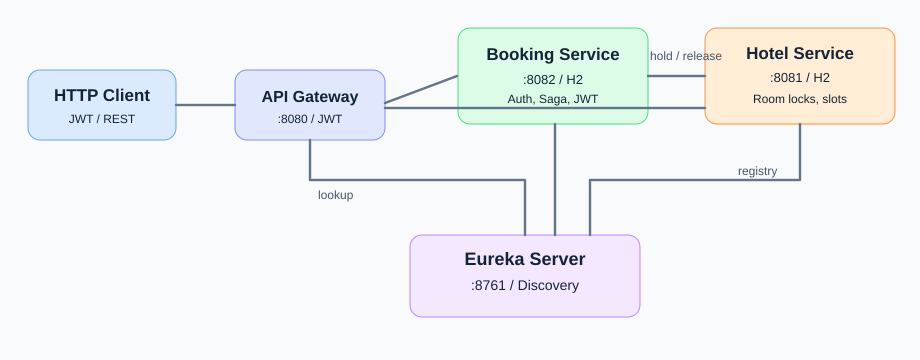

# Hotel Booking — микросервисы на Spring Boot

REST API для бронирования номеров с регистрацией, JWT, ролями, подбором по статистике и Saga-компенсацией. **4 независимых приложения**, у каждого backend-сервиса собственная H2 in-memory БД. Java 17+, Spring Boot 3.5.16, Spring Cloud 2025.0.3.



## Модули и порты

| Модуль | Порт | Назначение |
|---|---:|---|
| `discovery-server` | 8761 | Eureka, реестр сервисов |
| `api-gateway` | 8080 | JWT-проверка, маршрутизация `lb://` через Eureka, traceId |
| `hotel-service` | 8081 | Отели/номера, слоты занятости, аналитика, H2 |
| `booking-service` | 8082 | Пользователи, JWT, бронирования, двухшаговая Saga, H2 |

## Краткая инструкция проверки работы

- клонируем репозиторий:
  - git clone https://github.com/OboVladislav/hotel-booking-microservices.git
  - cd hotel-booking-microservices
- собираем проект: mvn clean package
- запускаем сервисы: .\start-all.ps1 
- проверяем запуск: 
  - Invoke-RestMethod http://localhost:8081/actuator/health
  - Invoke-RestMethod http://localhost:8082/actuator/health
  - Invoke-RestMethod http://localhost:8080/actuator/health
- запускаем автотесты: .\test-all.ps1

## Требования и запуск проекта на Windows

**Необходимое ПО:** JDK 17 или новее, Apache Maven 3.9+ и PowerShell 5.1/7. Docker и Kubernetes не нужны: сервисы запускаются обычными Java-процессами. Установку зависимостей Maven выполняет автоматически.

### 1. Настроить JWT (одинаково во всех сервисах)

Проверка и выпуск токенов используют **HS256**. Секрет должен содержать **не менее 32 байт UTF-8** и совпадать в трёх файлах:

- `booking-service/src/main/resources/application.yml`
- `hotel-service/src/main/resources/application.yml`
- `api-gateway/src/main/resources/application.yml`

Для **локального учебного запуска** можно использовать в каждом файле такой блок (одинаковый):

```yaml
security:
  jwt:
    secret: ${JWT_SECRET:my-hotel-booking-jwt-secret-key-2026-secure}
```

В исходной версии проекта уже указан другой достаточно длинный демонстрационный секрет по умолчанию. 

### 2. Собрать проект

Откройте PowerShell в корне репозитория, где находится общий `pom.xml`:

```powershell
java -version
mvn -version
mvn clean package
```

Ожидается `BUILD SUCCESS` для родительского проекта и четырёх модулей. Чтобы запустить только автоматические JUnit/MockMvc-тесты, используйте `mvn test`.

### 3. Запустить четыре сервиса

**Вариант А — по отдельности:** откройте четыре PowerShell-терминала в корне проекта и выполните по одной команде в указанном порядке:

```powershell
# Терминал 1 — Eureka (8761)
java -jar .\discovery-server\target\discovery-server-1.0.0.jar
```

```powershell
# Терминал 2 — Hotel Service (8081)
java -jar .\hotel-service\target\hotel-service-1.0.0.jar
```

```powershell
# Терминал 3 — Booking Service (8082)
java -jar .\booking-service\target\booking-service-1.0.0.jar
```

```powershell
# Терминал 4 — API Gateway (8080)
java -jar .\api-gateway\target\api-gateway-1.0.0.jar
```

**Не закрывайте терминалы:** Java-процессы работают, пока они запущены. Дождитесь сообщения `Started ...` в логах каждого сервиса.

**Вариант Б — одной командой**, когда все четыре порта свободны и JAR уже собраны:

```powershell
.\start-all.ps1
```

Этот скрипт последовательно запустит все четыре процесса и сохранит логи в `.run-logs/`. **Если Eureka уже запущена на 8761**, не запускайте `start-all.ps1` повторно: он специально остановится из-за занятого порта. Используйте вариант А для остальных сервисов или сначала остановите старые процессы.

### 4. Проверить работу

| Компонент | Ссылка | Что ожидать |
|---|---|---|
| Eureka | http://localhost:8761 | веб-панель регистрации сервисов |
| Hotel Swagger UI | http://localhost:8081/swagger-ui.html | документация API отелей |
| Booking Swagger UI | http://localhost:8082/swagger-ui.html | документация API бронирований |
| Gateway Health | http://localhost:8080/actuator/health | `{"status":"UP"}` |

В **Eureka → Instances currently registered with Eureka** должны отображаться `HOTEL-SERVICE`, `BOOKING-SERVICE`, `API-GATEWAY`.

Проверить здоровье приложений из PowerShell:

```powershell
Invoke-RestMethod http://localhost:8081/actuator/health
Invoke-RestMethod http://localhost:8082/actuator/health
Invoke-RestMethod http://localhost:8080/actuator/health
```

Ожидаемый ответ каждого приложения:

```json
{"status":"UP"}
```


### Учётные записи для демонстрации

При старте создаются **admin / admin123** (`ADMIN`) и **demo / demo123** (`USER`). В Hotel Service создаются два отеля и четыре номера. Пароли хранятся как BCrypt-хеши. В реальном окружении установите `ADMIN_USERNAME`, `ADMIN_PASSWORD` и **одинаковый** длинный случайный `JWT_SECRET` (32+ символов) для трёх сервисов и Gateway; демо-пароли и секрет **не используйте в production**.

Пример входа:

```bash
curl -X POST http://localhost:8080/api/user/auth \
  -H 'Content-Type: application/json' \
  -d '{"username":"demo","password":"demo123"}'
```

Из ответа скопируйте `accessToken` и передавайте `Authorization: Bearer <TOKEN>`. Токен действует **1 час**. Новый пользователь может зарегистрироваться через `POST /api/user/register` с JSON `{"username":"guest","password":"secret123"}`.

### Бронирование

Укажите актуальные даты (**startDate включительно, endDate не включительно**), например на две недели вперёд. Идентификатор запроса должен быть уникальным для каждого нового бронирования, но при повторе того же запроса — **тем же**.

```bash
curl -X POST http://localhost:8080/api/booking \
  -H 'Authorization: Bearer <TOKEN>' \
  -H 'X-Request-Id: my-booking-001' \
  -H 'Content-Type: application/json' \
  -d '{"startDate":"2026-12-10","endDate":"2026-12-12","autoSelect":true}'
```

`autoSelect=true` выбирает самый мало бронируемый **свободный** номер, сортировка по `timesBooked ASC`, затем `id ASC`. При `autoSelect=false` передайте `roomId`. Даты в примере замените на будущие при запуске. Повтор `X-Request-Id` не создаёт новую запись; повтор с отличающимися параметрами вернёт **409**.

```bash
curl -H 'Authorization: Bearer <TOKEN>' http://localhost:8080/api/bookings
curl -H 'Authorization: Bearer <TOKEN>' http://localhost:8080/api/booking/1
curl -X DELETE -H 'Authorization: Bearer <TOKEN>' http://localhost:8080/api/booking/1
curl -H 'Authorization: Bearer <TOKEN>' 'http://localhost:8080/api/rooms/recommend?startDate=2026-12-10&endDate=2026-12-12'
```

## Эндпойнты (через Gateway на :8080)

| Метод | Путь | Права | Функция |
|---|---|---|---|
| POST | `/api/user/register` | публично | регистрация и JWT |
| POST | `/api/user/auth` | публично | авторизация и JWT |
| GET | `/api/user` | ADMIN | все пользователи |
| POST | `/api/user` | ADMIN | создать пользователя |
| PATCH | `/api/user/{id}` | ADMIN | изменить имя/пароль/роль |
| DELETE | `/api/user/{id}` | ADMIN | удалить пользователя |
| POST | `/api/booking` | USER/ADMIN | создать бронирование, `X-Request-Id` |
| GET | `/api/bookings` | USER/ADMIN | история **своих** бронирований |
| GET | `/api/booking/{id}` | владелец/ADMIN | посмотреть бронирование |
| DELETE | `/api/booking/{id}` | владелец/ADMIN | отменить бронирование |
| GET | `/api/hotels` | USER/ADMIN | список отелей |
| POST | `/api/hotels` | ADMIN | создать отель |
| PUT | `/api/hotels/{id}` | ADMIN | изменить отель |
| DELETE | `/api/hotels/{id}` | ADMIN | удалить отель |
| GET | `/api/rooms?startDate=...&endDate=...` | USER/ADMIN | свободные номера за период |
| GET | `/api/rooms/recommend?startDate=...&endDate=...` | USER/ADMIN | подбор по частоте брони |
| GET | `/api/rooms/all` | ADMIN | все номера, включая недоступные |
| GET | `/api/rooms/stats` | ADMIN | `timesBooked`, число активных слотов на сегодня |
| POST | `/api/rooms` | ADMIN | добавить номер |
| PUT | `/api/rooms/{id}` | ADMIN | изменить номер |
| DELETE | `/api/rooms/{id}` | ADMIN | удалить номер без активных слотов |

Административный JSON создания отеля: `{"name":"New Hotel","address":"Street 1"}`. Номер: `{"hotelId":1,"number":"303","available":true}`. Админ-пользователь: `{"username":"manager","password":"secret123","role":"ADMIN"}`.

**Внутренние маршруты Hotel Service** доступны **только напрямую на :8081 с JWT роли SERVICE**, который создаёт Booking Service. Через Gateway они заблокированы: `POST /api/rooms/{id}/confirm-availability`, `/finalize`, `/release`.

### Как работает Saga

1. `Booking Service` сохраняет `PENDING` в локальной транзакции.
2. В `Hotel Service` вызов `confirm-availability` с `bookingId`: под `PESSIMISTIC_WRITE`-блокировкой строки номера проверяется пересечение `[startDate,endDate)` с активными слотами. Создаётся `HELD`.
3. `finalize` переводит слот в `CONFIRMED` и **ровно один раз** увеличивает `timesBooked`; Booking Service переводит локальную запись `PENDING → CONFIRMED`.
4. При ошибках или превышении времени ожидания Booking Service переводит запись в `CANCELLED` и вызывает `release` (компенсация). Если Hotel временно недоступен, `@Scheduled` повторяет незавершённые освобождения каждые 10 с.
5. При конкурентных бронированиях одного номера сериализация по строке комнаты исключает двойную запись; `409` означает занятость. При автоподборе пробуется следующий свободный номер.

Сетевые запросы ограничены тайм-аутами соединения **1 с**, чтения **1,5 с**, максимум **3 попытки** с интервалами **150/300 мс**. `bookingId` записывается в логи обеих служб, `X-Trace-Id` генерирует Gateway и передаёт через Booking Service в Hotel Service; ключевые события `PENDING/HELD/CONFIRMED/RELEASED/CANCELLED` логируются. Повторный hold/finalize/release по `bookingId` идемпотентен; `RELEASED`-запись сохраняется как tombstone для поздних сетевых повторов.

`available` означает техническую доступность номера (например, ремонт). **Занятость по датам** определяется только таблицей `room_slots` в Hotel Service; Booking Service хранит свою историю в `bookings`. Схема расширена `room_slots`, `request_id`, индексами и флагом отложенной компенсации.

## JWT и безопасность

- Токен действует **3600 секунд (1 час)**, роли: `USER`, `ADMIN` и внутренний `SERVICE` для вызовов Booking → Hotel.
- Gateway и оба backend-сервиса проверяют JWT самостоятельно; административные маршруты доступны только `ADMIN`.
- Минимальная длина секрета HS256 — **32 байта UTF-8**, а не просто 32 произвольных символа.
- При ошибке `JWT_SECRET must contain at least 32 UTF-8 bytes for HS256` проверьте переменную `$env:JWT_SECRET`, конфигурацию трёх сервисов и перезапустите Java-процессы.
- `401 Unauthorized` означает отсутствие/некорректность токена, `403 Forbidden` — отсутствие нужной роли, `409 Conflict` — конфликт бронирования или идемпотентности.

Пример проверки длины, не выводя секрет в консоль:

```powershell
if ($env:JWT_SECRET) {
    [Text.Encoding]::UTF8.GetByteCount($env:JWT_SECRET)
} else {
    'JWT_SECRET не задан; применяется значение по умолчанию из application.yml'
}
```

## Диагностика запуска в Windows

Команда `mvn clean package` должна завершиться статусом **SUCCESS для всех пяти модулей**.
Затем запустите `./start-all.ps1` (в PowerShell: `.\start-all.ps1`) из корня проекта.
Скрипт проверяет наличие **всех четырёх JAR до запуска**, проверяет занятые порты и
сохраняет ошибки в `.run-logs/<имя-сервиса>.stdout.log` и `.stderr.log`.

Проверить доступность сервиса можно через:

```powershell
Invoke-RestMethod http://localhost:8082/actuator/health
Invoke-RestMethod http://localhost:8080/actuator/health
Get-Content .\.run-logs\booking-service.stdout.log -Tail 70
Get-Content .\.run-logs\booking-service.stderr.log -Tail 70
```

Если `booking-service` не запускается, можно увидеть ошибку прямо в консоли:

```powershell
java -jar .\booking-service\target\booking-service-1.0.0.jar
```

При `JWT_SECRET` короче 32 байт приложение не стартует; этот секрет должен быть
одинаковым для Gateway, Booking и Hotel. Страница `http://localhost:8080/`
не является UI: на корневом пути Gateway допустим `404`, тестируйте `/actuator/health`.
Здесь используются локальные Java-процессы, а не Kubernetes Pod'ы.

## Проверка API и автоматические тесты

### Swagger и ручная проверка

- Booking Swagger: http://localhost:8082/swagger-ui.html
- Hotel Swagger: http://localhost:8081/swagger-ui.html
- JSON OpenAPI: `/v3/api-docs` на соответствующем backend-порту.

Демонстрационные учётные записи: **`demo / demo123`** (USER) и **`admin / admin123`** (ADMIN).

**Авторизация через Gateway** (сохраните результат и токен в текущем PowerShell):

```powershell
$base = 'http://localhost:8080'
$login = Invoke-RestMethod -Uri "$base/api/user/auth" -Method POST `
  -ContentType 'application/json' `
  -Body '{"username":"demo","password":"demo123"}'
$token = $login.accessToken
$headers = @{ Authorization = "Bearer $token" }
$login
```

Ожидается поле `accessToken` (JWT) и `expiresInSeconds: 3600`.

**Свободные номера и рекомендации** (даты динамически выбираются в будущем):

```powershell
$start = (Get-Date).AddDays(14).ToString('yyyy-MM-dd')
$end = (Get-Date).AddDays(16).ToString('yyyy-MM-dd')
Invoke-RestMethod -Uri "$base/api/hotels" -Headers $headers
Invoke-RestMethod -Uri "$base/api/rooms?startDate=$start&endDate=$end" -Headers $headers
Invoke-RestMethod -Uri "$base/api/rooms/recommend?startDate=$start&endDate=$end" -Headers $headers
```

Для проверки бронирования, повторной доставки, отказа по конфликту и отмены проще использовать скрипт ниже: он сам выбирает номер, генерирует `X-Request-Id` и удаляет большинство созданных тестовых сущностей.

### Один файл для end-to-end проверок: `test-all.ps1`

**Файл `test-all.ps1` лежит в корне репозитория**, рядом с `pom.xml` и `start-all.ps1`. Он **не запускает сервисы**, а проверяет уже работающие приложения через Gateway и Eureka.

Запуск:

```powershell
.\test-all.ps1
```

Если PowerShell запрещает выполнение локальных скриптов, используйте **только для этого запуска**:

```powershell
powershell -ExecutionPolicy Bypass -File .\test-all.ps1
```

Запуск API-проверок вместе с JUnit/MockMvc:

```powershell
.\test-all.ps1 -RunMavenTests
```

Скрипт проверяет:

1. Доступность Eureka, Hotel, Booking, Gateway и регистрацию сервисов в Eureka.
2. Логин `USER`/`ADMIN`, выдачу JWT, отказы `401` и `403` и блокировку внутренних эндпойнтов на Gateway.
3. Список отелей/номеров, валидацию дат (`400`), сортировку рекомендаций по `timesBooked ASC, id ASC`.
4. Создание бронирования → `CONFIRMED`, запрет пересекающегося бронирования (`409`).
5. Идемпотентность `X-Request-Id`, историю и получение брони по ID, отмену → `CANCELLED` и освобождение номера.
6. Автоподбор номера, CRUD отелей/номеров/пользователей администратором, регистрацию нового пользователя.
7. При `-RunMavenTests` — JUnit/MockMvc-тесты сценариев Saga, тайм-аутов, компенсации и конкурентных бронирований.

Вывод имеет формат:

```text
[PASS] USER login returns a JWT for demo
[PASS] Create booking -> CONFIRMED
[PASS] Overlapping booking with a NEW requestId -> 409
...
================= RESULTS =================
PASS: <количество>
FAIL: <количество>
```


> Скрипт изменяет состояние H2: создаёт/отменяет брони и выполняет временный CRUD. Данные H2 хранятся в памяти и сбрасываются при перезапуске соответствующего сервиса. Для воспроизводимой демонстрации можно перезапустить Hotel и Booking (с учётом Eureka).

### JUnit/MockMvc и CI

```powershell
mvn clean test
mvn clean verify
```

JUnit 5, MockMvc, Mockito и H2 используются для тестов на уровне модулей. Скрипт GitHub Actions в `.github/workflows/ci.yml` запускает `mvn -B clean verify` при push и pull request. Для тестов **только Maven** работающие HTTP-сервисы обычно не нужны; для `test-all.ps1` они обязательны.

## Структура БД

**Booking Service:** `users(id,username,password,role)`; `bookings(id,user_id,room_id,start_date,end_date,status,created_at,request_id,requested_room_id,auto_select,release_pending,compensating)`.

**Hotel Service:** `hotels(id,name,address)`; `rooms(id,hotel_id,number,available,times_booked)`; `room_slots(id,room_id,booking_id,reservation_key,start_date,end_date,state)`. Связи внутри своих БД через JPA, между сервисами — только по `roomId`/`bookingId` в API.

## ADR — основные решения

1. **H2 in-memory на каждом сервисе:** соответствует учебному ТЗ; данные стираются при перезапуске. Для production нужна персистентная БД.
2. **Saga, а не 2PC:** только локальные `@Transactional`, удалённые HTTP-вызовы, идемпотентность и компенсация. Между шагами возможна кратковременная согласованность, предусмотрены повторы освобождения.
3. **Защита:** JWT HS256 с общим секретом; роли проверяются Gateway и каждым сервисом. Сервисные вызовы используют токен `SERVICE`; они не публикуются в Gateway. В production лучше отдельные ключи и изоляция внутренней сети.
4. **Конкуренция:** блокировка строки `Room` через `PESSIMISTIC_WRITE`, проверка интервалов в том же локальном SQL-транзакционном контексте.

### Ограничения учебного проекта

H2 не хранит данные после завершения процесса. Нет аутентификационного сервера и отдельного хранилища идемпотентности (ключ хранится в таблице бронирований). Планировщик компенсации работает, пока Booking Service запущен. Для настоящей production-системы понадобятся persistent DB, outbox/очередь и фоновые reconciler-операции. API сделан минимальным, без Kubernetes, Kafka и внешних очередей.

## Структура проекта 


В корне проекта должны быть:

```text
hotel-booking-microservices/
├── .github/workflows/ci.yml
├── .gitignore
├── README.md
├── MODULES.md
├── architecture.svg
├── pom.xml
├── start-all.ps1
├── test-all.ps1
├── discovery-server/
├── api-gateway/
├── hotel-service/
└── booking-service/
```
